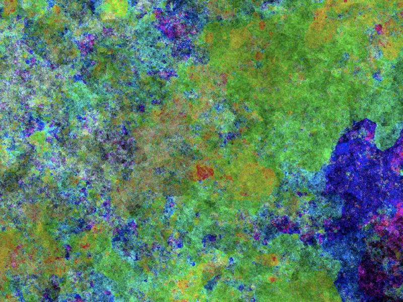

# IMA Traveller

> **This repo remains private unless the original authors give permission to
> publish it.**



## Intro

**IMA Traveller** (traveller 2.0c, 1996) is an artwork by Erwin Driessens &
Maria Verstappen: a cellular automaton that zooms endlessly into evolving,
organic pixel structures.  Every pixel splits into four children that
inherit color from their neighbors with slight mutation, so each generation
is twice the resolution of the last.  The infinite zoom is the automaton
itself.  Moving the cursor steers the journey toward the area beneath it.

This is a port of the original Windows 98 + OpenGL executable, reverse
engineered through Ghidra decompilation and AI-assisted analysis (Claude).  The
same C source builds natively for Mac, Windows and Linux, and for the browser
via Emscripten/WebAssembly.  It reproduces the original's cellular automaton
bit for bit and follows its renderer closely; source comments reference the
original's function addresses (`sub_XXXXXX`).

## Build

All headers and prebuilt libraries (freeglut-sdl2-ogles2, gl4es, ANGLE) are
vendored under `deps/`.  See [deps/README.md](deps/README.md) for provenance,
and use `./deps/refresh.sh` to re-vendor from sibling source trees.  The only
external requirements are SDL2 for native builds (`brew install sdl2`) and
emcc for web builds.  Every dependency path is a `?=` make variable, so
external trees can be swapped in.

```sh
make            # native -> ./bin-<os>-<arch>/traveller
make browser    # web    -> ./web/traveller.js + traveller.wasm
make selftest   # headless CA core check (see Verification)
make clean
```

The vendored ANGLE libraries are mac-arm64 only.  On Linux, GLES2/EGL
usually come from the system (Mesa): `make GLES_LIBS_PATH=/usr/lib/...`.
On Windows or Intel Macs, point `GLES_LIBS_PATH` at ANGLE libraries for that
platform.

## Run

```sh
make run            # native
make run-browser    # web, via emrun
```

Or serve `web/` with any static server, e.g.
`python3 -m http.server --directory web`, and open `traveller.html`.

The journey starts from a 4-pixel seed, so the first ~40 seconds are nearly
black while the pixels split and the structure grows to fill the screen.
This matches the original's pace.

**Controls**

| Input | Action |
|-------|--------|
| Mouse | Steer: the zoom travels toward the area under the cursor |
| Right button | Menu: freeze, speed, steer, sync, rate, filter, detail, quit |
| `F1` / `p` | Freeze |
| `F4` / `s` | Single step while frozen |
| `ESC` | Quit (native: prints the original's cycle/fps stats) |

**Config**: `traveller.config` in the working directory uses the same keys
and defaults as the original:

```
speed 2          # 1..4 -> 1/2/4/8 CA rows per frame (5 = 16: port extension)
rate 60          # target fps for sync CLOCK
steer LINEAR     # LINEAR | CURVED (Hermite-interpolated pan)
sync CLOCK       # FREE | CLOCK | CHRONO | VBLANK
filter NEAREST   # NEAREST | LINEAR texture filtering
detail LOW       # LOW 768x512 | MEDIUM 1024x768 | HIGH 1280x1024
                 # | ULTRA 2048x1536 | ULTRA2 2560x2048
                 # (ULTRA/ULTRA2: port extensions for retina drawables)
xres 640         # window width: 640 | 800 | 1024
fullscreen no
```

If `detail` is not set, the port matches it to the drawable height at
startup, so a texel is ~1 pixel at generation start, as with the original's
window/CA pairings.  Without this, large modern windows turn blocky long
before each generation's refinement arrives.  Retina-class drawables select
ULTRA (over ~1140 px tall) or ULTRA2 (over ~1700 px).  Auto-selected detail
also raises `speed` (unless set) to keep the original's ~2x zoom per 2.2 s:
MEDIUM/HIGH -> 3, ULTRA -> 4, ULTRA2 -> 5.  Set `detail LOW` and `speed 2`
for the literal 1998 behavior.

**Command line** (port extensions): `-seed N` fixes the RNG seed (default
`time(0)`, like the original); `-trial` quits after 101 generations, as the
original demo build did; `-dump N` writes a BMP per generation and quits
after N (headless render verification).

## Implementation details

### Source layout

| File | Contents |
|------|----------|
| `ima_core.c/h` | The CA engine: RNG, mutation table, breeding rules, palette. Pure C, no GL. |
| `traveller.c` | The "zoomer": GLUT app reproducing the original's immediate-mode renderer. |
| `ima_selftest.c` | Headless checksum harness (see Verification). |
| `Makefile` | Native + Emscripten build, modeled on newave.mk in freeglut-sdl2-ogles2. |
| `web/traveller.html` | Hand-maintained page that loads `web/traveller.js`. |

### The cellular automaton

Each generation reads a half-size region of the previous image around the
focus point.  Every parent pixel breeds a 2x2 block of children; each child
inherits each HSV channel from whichever of 3 neighbors is closest to the
parent, plus a small mutation from a 16x16 table indexed by pixel bits and a
lagged-Fibonacci RNG.  Pixels are 15-bit `(H<<10)|(S<<5)|V`.

### The renderer

- The CA image (default 768x512) is converted through a 32768-entry palette
  to **RGBA5551** and tiled into a grid of **256x256 `GL_RGB5_A1` textures**
  (the Win98-era max texture size).  There are two texture sets, swapped
  every generation.
- Each frame draws the tile grid as `GL_TRIANGLE_STRIP` quads (immediate
  mode, identity projection/modelview) over an NDC rectangle that grows by
  `2^(1/frames_per_generation)` per frame: an almost seamless 2x zoom per
  generation, panning toward the focus point.
- Evolution is **amortized**: `speed` selects 1/2/4/8 CA rows evolved per
  displayed frame.  When a generation completes, the new image is uploaded
  one tile per frame (with the original's dummy `GL_POINTS` draw to force the
  transfer), then the texture sets swap and the zoom rectangle resets.
- Rendering is at full device resolution on every target
  (`SDL_WINDOW_ALLOW_HIGHDPI` natively, a devicePixelRatio-scaled canvas on
  the web); any remaining blockiness is texel density, not scaling.

### Differences from the original

- **Timing** uses `SDL_GetPerformanceCounter` (the original used
  `QueryPerformanceCounter`).  On the web the busy-wait pacing is skipped and
  requestAnimationFrame provides ~60 Hz.
- **Tile uploads**: the original ran the generation-end uploads in one
  message-loop iteration with one real buffer swap per tile.  This port runs
  each upload as its own display callback (exactly one `glutSwapBuffers` per
  callback): the same paced frames natively, and the correct contract under
  requestAnimationFrame, which composites once per callback however many
  swaps are issued.
- **Steering start**: the original warped the Windows cursor to the center
  for the first 3 generations, so steering began from center.  Browsers
  cannot warp the pointer, so the port keeps the focus centered until, after
  those 3 generations, the pointer moves ~8 points from where it rests.  From
  then on every pointer movement steers, as in the original.
- **Buffering**: the original could run single-buffered (`doublebuffer no` +
  `glFinish`); this port always double-buffers.
- **Extensions**: the ULTRA/ULTRA2 detail levels, speed 5, auto-matched
  detail, and the command-line options above.

### Verification

The CA core is **bit-exact** with the Python reference implementation
(`ima-traveller` repo, `ima_traveller_final.py`):

```sh
make selftest
# vs.
python3 ima_traveller_final.py --seed 12345 --frames 12 --checksums
```

Both print identical per-generation CRC32s of the CA buffer (verified for
768x512 and 1024x768, 40+ generations).

## Credits

**IMA Traveller** (traveller 2.0c, 1996) is an artwork by
[Erwin Driessens & Maria Verstappen](https://www.driessensverstappen.nl/expanding-structures/ima-traveller/ima-traveller.html).
All rights in the original work remain with the artists.  This is an
unofficial, non-commercial port; the original executable is not included.

Port by [Erik Larsen](https://github.com/erik-larsen).

Vendored libraries (see [deps/README.md](deps/README.md)):

| Library | License | Notice |
|---------|---------|--------|
| [freeglut](https://github.com/sgi-demos/freeglut) (SDL2 + GLES2 fork) | MIT/X11 | [deps/freeglut/COPYING](deps/freeglut/COPYING) |
| [gl4es](https://github.com/ptitSeb/gl4es) | MIT | [deps/gl4es/LICENSE](deps/gl4es/LICENSE) |
| [ANGLE](https://chromium.googlesource.com/angle/angle) | BSD 3-clause | [deps/angle/LICENSE](deps/angle/LICENSE) |

Also built on [SDL2](https://www.libsdl.org) (zlib license; system or
Emscripten port, not vendored) and [Emscripten](https://emscripten.org).
